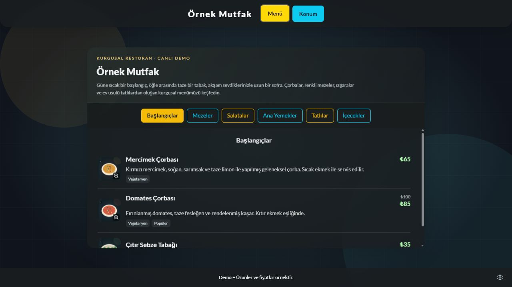

# QRMenu

**Kendi hesabınızda yayınlayabileceğiniz, yönetim panelli ve mobil uyumlu dijital menü.**

React arayüzü, Netlify Functions API ve Netlify Blobs depolaması tek projede çalışır. Ayrı bir sunucu, Supabase hesabı veya veritabanı kurulumu gerekmez. Depoyu kendi GitHub hesabınıza alıp Netlify'a bağlayarak kullanabilirsiniz.

Başlangıçta kurgusal **Örnek Mutfak** menüsü açılır: **6 kategori, 21 ürün**, açıklamalar, fiyatlar, indirimli ürünler, etiketler, tükenen ürün örneği ve dolu iletişim bölümü. Ürün çizimleri projeye dahildir; harici görsel servislerine ihtiyaç duymaz. İsim, adres, telefon, sosyal hesap ve Wi-Fi bilgileri tamamen örnektir.

[](https://app.netlify.com/start/deploy?repository=https://github.com/dev-trukafatsum/QRMenu)

> Bu düğme kaynak depo public olduktan sonra kullanılabilir. Önce aşağıdaki yönetici hesabı adımını tamamlayın. Her kullanıcı kendi giriş bilgilerini üretir; ortak bir demo yönetici şifresi yoktur.



## Özellikler

- Mobil ve masaüstü için kategori sekmeli menü, görsel büyütme ve iletişim paneli.
- Ürün ekleme, düzenleme, silme, sıralama, fiyat ve stok durumu yönetimi.
- Kategori yönetimi; popüler, yeni, acılı ve vejetaryen gibi ürün etiketleri.
- Restoran bilgileri, arka plan, çalışma saatleri, Wi-Fi ve sosyal bağlantılar.
- Mevcut sitenin adresine yönlenen, indirilebilir ve yazdırılabilir QR kodu.
- Kalıcı kayıt, yönetici oturumu, mevcut şifreyle kullanıcı adı/şifre değiştirme.
- Kendi işletmenize geçerken panelden kapatılabilen demo modu.

## Teknoloji yığını

| Katman | Kullanılan teknolojiler |
| --- | --- |
| Arayüz | React 18, TypeScript |
| Derleme | Vite 8 |
| Tasarım | Tailwind CSS 3, özel CSS, Lucide React |
| Backend | Netlify Functions, Node.js 22 |
| Kalıcı veri | Netlify Blobs |
| Veri doğrulama | Zod 4 |
| QR kod | qrcode.react 4 |
| Kimlik doğrulama | Node.js crypto / scrypt, HttpOnly ve SameSite çerezleri |
| Test ve kod kalitesi | Vitest 5, ESLint 9, TypeScript kontrolü |
| Yayınlama | GitHub → Netlify otomatik deploy |

## Hızlı kurulum: GitHub → Netlify

### 1. Depoyu kendi hesabınıza alın

GitHub'da **Fork** seçeneğini kullanın. Fork'unuzu bilgisayarınıza klonlayın ve proje klasörünü açın. Node.js **22.12 veya üzeri** kurulu olmalıdır; Netlify yapılandırması Node.js 22 kullanır.

```sh
npm ci
npm run admin:setup
```

İkinci komut yönetici e-postanızı ve en az 12 karakterlik şifrenizi ister. Şifreyi yazarken ekranda görünmez. Komut şu iki değeri üretir:

```dotenv
ADMIN_EMAIL=yonetici@example.com
ADMIN_PASSWORD_HASH=<komutun ürettiği salt:hash değerinin tamamı>
```

`ADMIN_PASSWORD_HASH` alanına düz şifrenizi yazmayın. Çıktıdaki değeri iki nokta dahil eksiksiz kopyalayın. Yukarıdaki yer tutucu çalışır bir şifre değildir.

### 2. Netlify'a bağlayın

Netlify'da **Add new project → Import an existing project → GitHub** yoluyla kendi fork'unuzu seçin. Alternatif olarak üstteki **Deploy to Netlify** düğmesiyle hesabınızda yeni bir kopya oluşturabilirsiniz; düğme kaynak depoyu kullanır.

| Ayar | Değer |
| --- | --- |
| Production branch | Kendi deponuzun ana dalı, genellikle `main` |
| Base directory | Bu deponun mevcut yapısında boş bırakın |
| Build command | `npm run build` |
| Publish directory | `dist` |
| Functions directory | `netlify/functions` |
| Node.js | `22` (`netlify.toml` içinde tanımlı) |

Proje başka bir deponun alt klasöründeyse Base directory'yi o klasöre ayarlayın. Eski `project` klasörü varsayımını kullanmayın; bu depoda `package.json` köktedir.

### 3. Ortam değişkenlerini ekleyin

Netlify proje ayarlarındaki **Environment variables** bölümüne kendi ürettiğiniz değerleri ekleyin:

| Değişken | Zorunlu mu? | Kullanım |
| --- | --- | --- |
| `ADMIN_EMAIL` | Yönetici girişi için evet | İlk yönetici e-postası |
| `ADMIN_PASSWORD_HASH` | Yönetici girişi için evet | `npm run admin:setup` çıktısı |

Kapsam seçimi sunuluyorsa **Functions** kapsamını dahil edin. Canlı kullanım için **Production** bağlamında tanımlayın. Deploy Preview'da yönetici girişi istiyorsanız ilgili bağlam için de ayrı giriş bilgileri tanımlayabilirsiniz.

Bu değişkenlere `VITE_` öneki eklemeyin; tarayıcıya gönderilmemelidir. `.env` dosyanızı GitHub'a yüklemeyin. `VITE_PUBLIC_MENU_URL` artık gerekli değildir: QR, açtığınız sitenin adresinden oluşturulur.

Değişkenler olmadan ziyaretçi demosu açılır, yönetici girişi ise yapılandırma hatası gösterir. Değişken ekledikten veya değiştirdikten sonra yeni bir deploy başlatın.

### 4. Yayınlayın ve kontrol edin

1. İlk build ve deploy'un tamamlanmasını bekleyin.
2. Netlify'ın verdiği site adresinde menüyü açın.
3. Adresin sonuna `/#admin` ekleyin veya menü altındaki yönetici simgesine basın.
4. Kendi e-posta ve şifrenizle giriş yapın.
5. Bir ürün fiyatını değiştirip **Kaydet** deyin. Sayfayı yenileyip kaydın korunduğunu kontrol edin.
6. Ziyaretçi menüsünü yeniden açın; önbellek nedeniyle değişiklik en fazla 60 saniye sonra görünebilir.

Yalnızca `dist` klasörünü sürükleyip bırakmak backend'i yayınlamak için yeterli değildir. Git bağlantılı tam build kullanın. GitHub'a gönderdiğiniz sonraki commit'ler bağlı dal üzerinden yeni deploy başlatır; panelde yapılan menü değişiklikleri için deploy gerekmez.

## Yerelde geliştirme

Bağımlılıkları yükledikten ve yönetici bilgilerini ürettikten sonra `.env.example` dosyasını aynı klasörde `.env` adıyla kopyalayın. Ürettiğiniz iki değeri ekleyin:

```sh
npm run dev
```

**http://localhost:8888** adresini açın. Bu komut Vite, Functions ve yerel Blobs hizmetini birlikte çalıştırır. `npm run dev:frontend` yalnızca arayüz geliştirme sunucusunu açar; 5173 portunda backend çalışmaz.

Yerel veriler `.netlify` altında tutulur ve canlı siteye aktarılmaz. `.env`, `.netlify`, `node_modules` ve `dist` Git tarafından yok sayılır.

## Demoyu kendi işletmenize uyarlama

1. **Restoran Ayarları** bölümünden isim, açıklama, adres, telefon, çalışma saatleri, Wi-Fi ve sosyal bağlantıları düzenleyin.
2. **Demo modu** seçeneğini kapatıp **Ayarları Kaydet** düğmesine basın. Demo açıkken telefon, Instagram ve harita alanları örnek olarak gösterilir; gerçek bağlantı açılmaz. Kapalıyken girdiğiniz gerçek bilgiler kullanılır.
3. **Menü Yönetimi** bölümünden ürün ve kategorileri düzenleyin. Ürün formundaki **Kaydet / Ekle** düğmeleri doğrudan sunucuya kaydeder. Kategori, silme, sıralama ve stok durumu işlemleri hemen kaydedilir.
4. Görselleri `public/img/` içine ekleyip `/img/dosya.jpg` yolunu kullanın veya bir HTTPS görsel adresi girin. Panelden dosya yükleme henüz yoktur. Örnek SVG çizimleri `public/img/demo/` altında değiştirilebilir.
5. Son alan adınızı bağladıktan sonra o adresten **QR Kod** bölümünü açıp QR'ı indirin. Localhost veya deploy preview adresinden basılı QR hazırlamayın. Alan adı değişince yeni QR indirmek gerekir; menü içeriği değişince gerekmez.

Instagram alanı kullanıcı adı, `@kullanıcıadı` veya tam profil bağlantısını kabul eder. Boş/kırık ürün görsellerinde yerel yedek görsel gösterilir. Restoran adı zorunludur; diğer iletişim alanları isteğe bağlıdır.

## Veri saklama ve oturumlar

- Her Netlify sitesi kendi Blobs verisine sahiptir. Fork alanların menüleri ve hesapları birbirinden bağımsızdır; kaynak deponun canlı verileri GitHub ile kopyalanmaz.
- Başlangıç menüsü `src/data.ts` içindedir ve depoda kayıt yokken kullanılır. İlk başarılı kayıt kalıcı menüyü oluşturur. Sonradan `src/data.ts` değiştirmek kayıtlı menünün üzerine yazmaz.
- Üretim deposu `qrmenu-demo-production` adını taşır. Bu ad bir teknik isimdir; demo modunu kapatmak depoyu değiştirmez ve veriyi sıfırlamaz. Önizleme depoları deploy kimliğiyle ayrılır; yeni preview eski preview verisini devralmaz.
- Menü, giriş bilgileri ve oturumlar Blobs'ta tutulur. Yeni üretim deploy'ları kayıtlı menüyü korur.
- Yönetici oturumu 8 saat geçerlidir. Çıkış oturumu iptal eder. Şifreler rastgele tuzla scrypt özeti olarak saklanır; HTTPS üzerinde çerez Secure, HttpOnly ve SameSite korumaları kullanır.
- **Restoran Ayarları → Giriş Bilgileri** bölümünde mevcut şifrenizle kullanıcı adı veya şifre değiştirebilirsiniz. İşlem eski oturumları geçersiz kılar; yeniden giriş yapmanız gerekir.
- Hesabı kurtarmak için `npm run admin:setup` ile yeni bilgiler üretin, Netlify'daki başlangıç değişkenlerini değiştirip yeniden deploy edin. Bu işlem paneldeki eski giriş bilgilerini geçersiz kılar. Rutin deploy'larda bu değişkenleri değiştirmeyin.
- Aynı menü iki oturumda düzenlenirse eski sürümün kaydı reddedilir. Değişikliklerinizi not alıp sayfayı yenileyerek tekrar deneyin.

## Proje yapısı

```text
src/
  components/       Ziyaretçi menüsü, yönetim, giriş ve QR ekranları
  data.ts           Dolu örnek menü
  context.tsx       Paylaşılan menü durumu
  menu-store.ts     Kayıt ve yükleme sıralaması
netlify/functions/  Menü ve oturum API'leri
server/             Doğrulama, hesap ve veri erişimi
public/img/         Projeyle birlikte yayınlanan görseller
scripts/            Yönetici hesabı hazırlama
tests/             Otomatik testler
netlify.toml        Build, Functions ve şablon ayarları
.env.example        Değersiz ortam değişkeni şablonu
```

## Komutlar

| Komut | Açıklama |
| --- | --- |
| `npm ci` | Kilit dosyasındaki sürümlerle bağımlılık kurulumu |
| `npm run dev` | Backend dahil yerel geliştirme |
| `npm run admin:setup` | İlk yönetici bilgilerini üretir |
| `npm run build` | TypeScript kontrolü ve üretim derlemesi |
| `npm run lint` | Kod kalitesi kontrolü |
| `npm test` | Vitest testleri |

Testler; giriş ve yetkilendirme, oturum iptali, veri doğrulama, kayıt çakışmaları, kayıt sonrası kalıcılık ve eski yüklemelerin yeni değişikliklerin üzerine yazmaması gibi davranışları kapsar. Blobs testlerde taklit edilir; Netlify hesabınızdaki ilk deploy sonrasında yukarıdaki kısa kontrolü yapın.

## Sorun giderme

| Sorun | Kontrol |
| --- | --- |
| Yönetici hesabı yapılandırılmadı | İki ortam değişkeni de mevcut mu, Functions/Production kapsamına uygulanıyor mu, ardından deploy yapıldı mı? |
| Şifre kabul edilmiyor | Hash'in tamamı kopyalandı mı? Hash alanına düz şifre yazılmış olabilir mi? Panelden sonradan değiştirdiğiniz bilgilerle mi giriş yapıyorsunuz? |
| Yerelde API çalışmıyor | `npm run dev` ve 8888 portunu kullanın. |
| Değişiklik ziyaretçide görünmüyor | Kayıt başarılı mı? 60 saniye sonra sayfayı yenileyin. |
| Başlangıç menüsündeki değişiklik görünmüyor | Kalıcı kayıt varsa başlangıç verisi yeniden yüklenmez; panelden düzenleyin. |
| QR yanlış adrese gidiyor | QR'ı canlı ve kalıcı alan adından yeniden indirin. |
| İlk deploy başarısız | Base directory, build komutu, Node sürümü ve build logunu kontrol edin. |

## Ücretsiz plan ve sınırlar

Netlify Free üzerinde çalışacak şekilde tasarlanmıştır; bu sınırsız trafik veya ücretsiz kullanım garantisi değildir. Deploy, trafik, Functions ve depolama hesabınızın geçerli kotalarına tabidir. Güncel sınırlar için [Netlify fiyatlandırmasını](https://www.netlify.com/pricing/) ve hesabınızdaki Usage & billing ekranını kontrol edin. Düzenli sorgulama yerine ziyaretçi isteğiyle yükleme ve 60 saniyelik önbellek kullanılır.

Bu sürüm tek işletme ve tek yönetici hesabına yöneliktir. Online sipariş, ödeme, çoklu işletme, dosya yükleme ve e-postayla şifre sıfırlama içermez. Süresi dolmuş oturum kayıtlarının otomatik temizliği henüz yoktur.

## Lisans ve kaynaklar

[MIT lisansı](LICENSE). Projeye dahil örnek yemek ve konum SVG çizimleri de aynı lisansla kullanılabilir. Kendi eklediğiniz görsellerin kullanım haklarını kontrol edin. Arayüz Google Fonts kullanır; erişilemezse sistem yazı tiplerine döner. Gerçek işletme modunda adres varsa Google Maps gömülü haritası kullanılır.

- [Netlify Git bağlantılı yayın ve deploy şablonları](https://docs.netlify.com/deploy/create-deploys/)
- [Netlify ortam değişkenleri](https://docs.netlify.com/build/environment-variables/get-started/)
- [Netlify Blobs](https://docs.netlify.com/build/data-and-storage/netlify-blobs/)

